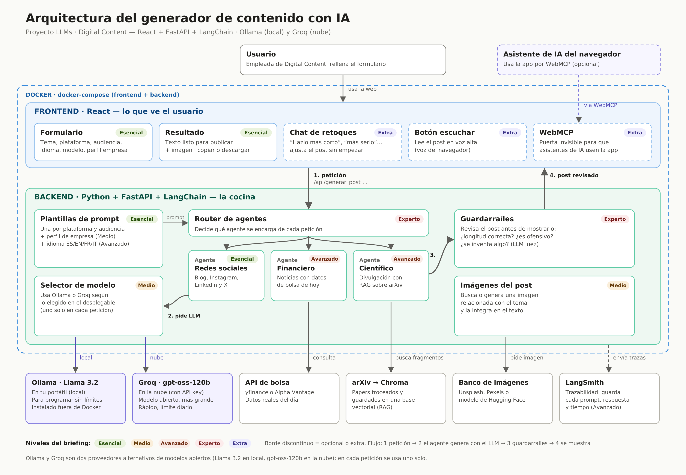

# IdeaLab Content

**🔗 Pruébalo online:** https://idealab-content.vercel.app

> El backend está en el plan gratuito de Render y se duerme tras un rato sin uso: la primera generación puede tardar hasta un minuto.

(aquí sigue lo que ya tenías: la descripción, "Cómo arrancarlo", etc.)

Generador de contenido para blogs y redes sociales con IA generativa: LLMs, LangChain, RAG y agentes.

> 🚧 **En desarrollo.** Prueba de concepto construida por niveles, de Esencial a Experto.

## Qué es

**Digital Content** es una agencia que publica a diario en blogs, Instagram, LinkedIn y X.
IdeaLab Content genera contenido **listo para publicar**, con texto e imagen, a partir de un tema,
una plataforma, una audiencia y un idioma, usando solo modelos locales o APIs gratuitas.

## Arquitectura objetivo

Diseño completo del sistema. Se construye por niveles: la tabla de **Estado** indica qué partes están ya implementadas.



- **Frontend:** React, Vite y Tailwind CSS.
- **Backend:** Python, FastAPI y LangChain.
- **Modelos:** Llama 3.2 en local con Ollama, o gpt-oss-120b en la nube con Groq.
- **Avanzado:** RAG sobre papers de arXiv con Chroma, trazabilidad con LangSmith y agentes con LangGraph.

## Estado

| Nivel | Contenido | Estado |
|---|---|---|
| 🟢 Esencial | Posts por plataforma y audiencia, interfaz web | ⏳ |
| 🟡 Medio | Selector de modelo, perfil de empresa, imágenes, Docker | ⏳ |
| 🟠 Avanzado | LangSmith, cuatro idiomas, noticias financieras, RAG científico | ⏳ |
| 🔴 Experto | Guardarraíles, multiagente, Graph RAG | ⏳ |

## Metodología

El proyecto sigue un enfoque de **desarrollo guiado por especificaciones**. Antes de programar,
el diseño y las tareas se definen en `.specify/`:

- [`1_spec.md`](.specify/1_spec.md): qué se construye, decisiones de arquitectura y contratos.
- [`2_plan.md`](.specify/2_plan.md): cómo se organiza el trabajo.
- [`3_tasks.md`](.specify/3_tasks.md): tareas con su criterio de "hecho" y calendario.

Cada tarea tiene su issue, su rama y su pull request. El progreso se sigue en el tablero del proyecto.

## Cómo arrancarlo

### Requisitos

- [uv](https://docs.astral.sh/uv/) (gestiona Python 3.12 y las dependencias del backend)
- [Node.js](https://nodejs.org/) 20.19 o superior
- Una clave gratuita de [Groq](https://console.groq.com/keys)
- *Opcional:* [Ollama](https://ollama.com/) con el modelo `llama3.2`, para generar en local sin internet

### 1. Clonar y configurar

```bash
git clone https://github.com/camiua/idealab-content.git
cd idealab-content
cp .env.example .env
```

Abre `.env` y escribe tu clave en `GROQ_API_KEY`. El archivo `.env` nunca se sube al repositorio.

Activa también el detector de secretos, que impide subir claves por error:

```bash
uv tool install pre-commit
pre-commit install
```
### Opción rápida: Docker

Con [Docker Desktop](https://www.docker.com/products/docker-desktop/) instalado y la clave en `.env`, un solo comando arranca todo:

```bash
docker compose up --build
```

La web queda en http://localhost:5173 y la API en http://localhost:8000. Ollama no va dentro de Docker: si lo tienes instalado, el backend lo usa desde tu ordenador.

Si prefieres arrancarlo sin Docker, sigue los pasos 2 y 3.

### 2. Arrancar el backend (terminal 1)

```bash
cd backend
uv sync
uv run uvicorn app.main:app --reload
```

La API queda en http://localhost:8000 y su documentación interactiva en http://localhost:8000/docs.

### 3. Arrancar el frontend (terminal 2)

```bash
cd frontend
npm install
npm run dev
```

Abre http://localhost:5173, escribe un tema, elige plataforma, audiencia y modelo, y pulsa **Generar post**.

### Ollama (opcional)

Para generar en local, instala Ollama y descarga el modelo:

```bash
ollama pull llama3.2
```

En la interfaz, elige **Ollama · en local**. Es mucho más lento que Groq (unos 30 s por post en un portátil sin GPU). Si Ollama no está arrancado, la app lo indica con un mensaje claro.

### Banco de pruebas de prompts

Mide la calidad de las plantillas de prompt con 20 posts en condiciones fijas. Desde `backend/`:

```bash
uv run python -m scripts.eval_prompts --label prueba
```

Los resultados se guardan en `docs/eval/`. La evolución de los prompts y la comparación entre versiones están en [`docs/prompt-engineering.md`](docs/prompt-engineering.md).

### Activar el detector de secretos

Después de clonar el repositorio, activa la comprobación automática que impide subir claves por error:

```bash
uv tool install pre-commit
pre-commit install
```

## Herramientas de desarrollo

- **VS Code**: editor
- **Git y GitHub**: control de versiones, issues y tablero Kanban
- **Docker Desktop**: contenedores
- **Claude**: asistente para consulta técnica y revisión de código

## Licencia

[MIT](LICENSE)
